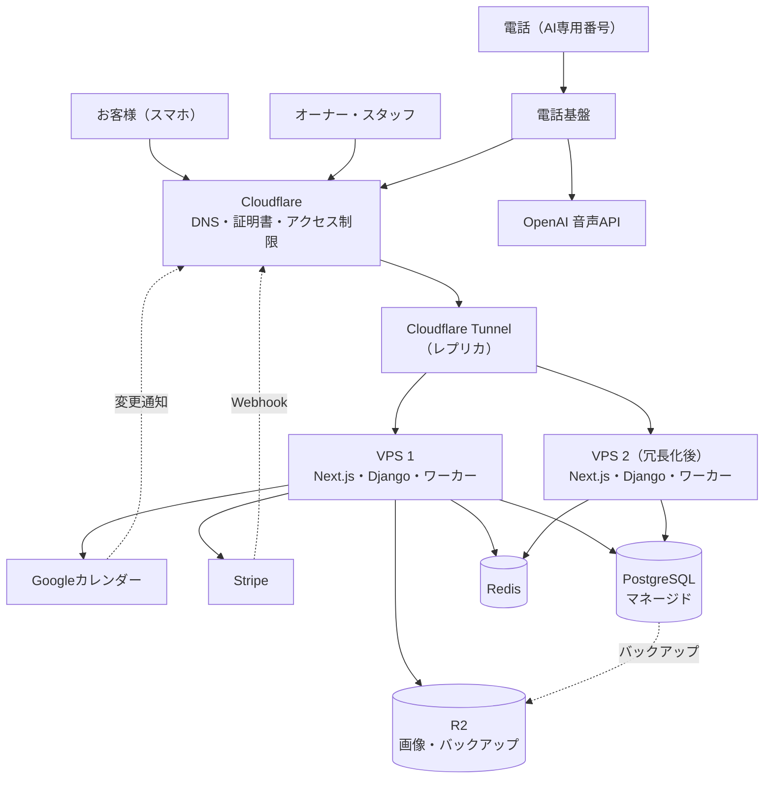

# ヨヤクル（yoyakuru）要件定義 v0.2

整理日：2026年11月4日  
状態：会話に基づく要件整理・実装前  
対象：マルチテナント型AI予約SaaS／第一号導入候補は伏見整体院

## 1. 目的と位置付け

お客様が予約状況を見ながら、選択式の操作・自由入力チャット・電話のいずれからも予約できる。店舗は共通の予約台帳とGoogleカレンダーで管理する。

基本体験は「予約状況の表示＋チャットボット（選択＋任意入力）＋AI通話」。電話代行だけを主商品とせず、予約受付全体を一元化する。成果は予約完了率、誤予約、店舗の受付負担、原価で評価する。

### 1.1 事業方針

事業方針（BIZ-01〜10）と90日の進め方は、[事業方針](business-plan.md)に分けた（2026-11-05）。本書のBIZ-xxは同資料を指す。

## 2. 合意状況・料金方針

| 項目 | 現時点の扱い |
|---|---|
| 名称：ヨヤクル／yoyakuru | 決定 |
| テナント型・Google連携・Stripe月額課金 | ユーザー要望 |
| 予約状況表示＋選択と自由入力のチャット＋AI通話 | ユーザー提示の基本構成 |
| 月額1,980円（税込）に予約表示・予約管理・チャット・Google連携を含める | 目標。税込で決定（税抜約1,800円）。チャットの別プラン化はしない |
| 電話番号1つも基本料に含める | 直近の検討案。採算・契約条件の確認が必要 |
| AI電話とチャットの利用は、プランごとの月間の確定予約件数の枠にまとめる（選択式のWeb予約は無制限、USAGE-01a） | 案。電話プラン3,980円を主力、1,980円を入口とする（BIZ-04）。通話時間の従量課金は採用しない方向で検討中。件数・プラン・超過時の扱いは未決定 |
| オーナーとスタッフのログイン | 要件案として整理。権限詳細は本書の初期案 |
| スタッフ3人でも店舗基本料は同じ | 料金設計案。3人の運用を必須検証対象とする |
| スタッフ別Googleカレンダー | 基本方式案。個人アカウント接続は下記参照 |
| OpenAIの音声会話API | ユーザー希望。モデル・接続方式は未決定。台本による原価の初回計測（2026-11-05）では、AI音声の原価は1分あたりminiが約2.4円、上位モデルが約7.8円。スタンダード案（3,980円・180分）の粗利目安40％を満たすのはminiのみ（[原価](costs.md)）。モデルは実通話での品質確認後に決める |
| 初号店：伏見整体院 | 導入目標。契約・事例公開承認は未確認 |

1,980円は税込で決定（2026-11-04）。原価・粗利の試算は税抜約1,800円とStripe手数料を前提にする。22円/分、接続10円＋12円/分、チャット月980円・100会話などは過去の検討例であり、現行の正式価格・上限に採用しない。旧企画書の月14,800円も現行方針ではない。

## 3. 利用者・権限

同一人物がオーナーと施術担当者を兼ねられる。ログインユーザーと予約担当者を区別し、スタッフ追加だけで料金を自動加算しない。

| 操作 | オーナー | スタッフ（初期案） | 予約するお客様 |
|---|---|---|---|
| 公開の空き状況・チャット予約 | 利用可 | 利用可 | 利用可 |
| 予約の確認・作成・変更・取消 | 店舗全体 | 自分の担当分 | 自分の予約の取消のみ（確認メールのリンク。電話は氏名・日時の口頭確認）。変更は取消して再予約 |
| 休憩・予約不可時間 | 全員分 | 自分の分 | 不可 |
| メニュー・営業時間・資源設定 | 可 | 不可 | 不可 |
| スタッフ招待・無効化・権限設定 | 可 | 不可 | 不可 |
| Google接続・店舗設定 | 可 | 個人接続を採用する場合のみ本人接続可 | 不可 |
| 契約・支払い・電話利用設定 | 可 | 不可 | 不可 |
| 他スタッフの予約詳細 | 可 | 店舗設定で許可した範囲 | 不可 |

スタッフの他担当予約への編集許可は初期には付与しない案。受付担当など追加ロールは将来検討する。権限判定はサーバーで行い、画面非表示だけに依存しない。停止済みスタッフのログインと既存セッションを無効にする。

店舗利用者は個別アカウントでログインする。ログイン方式はLOGIN-07〜08に従う。招待期限、退会・オーナー引継ぎは詳細設計で決める。お客様は会員登録なしで予約できる。氏名・連絡先の確認はCUST-01〜08に従う。

## 4. 機能要件

### 4.1 公開予約画面

| ID | 要件 |
|---|---|
| WEB-01 | 店舗ごとのURLで、メニュー・担当者・予約可能日時をスマホから確認できる |
| WEB-02 | 公開するのは予約可能枠。予約者名・連絡先・私用予定の内容は表示しない |
| WEB-03 | メニューの所要時間、担当者の勤務・休憩、ベッド等を考慮した枠を表示する |
| WEB-04 | 指名あり／指名なしを選べる。指名なしは対応可能スタッフの候補から割り当てる |
| WEB-05 | 表示後に枠が埋まった場合は確定を拒否し、最新の候補を案内する |

### 4.2 選択＋自由入力のチャット

| ID | 要件 |
|---|---|
| CHAT-01 | 初回／再来、メニュー、担当者、日時を選択肢で進められる |
| CHAT-02 | 自由入力を使わなくても、新規予約が完了できる |
| CHAT-03 | 途中で自由入力の質問を受け、回答後に入力済みの予約条件を保って続けられる |
| CHAT-04 | 自由入力から得た日時・メニューも店舗ルールに照らして検証し、確認画面を経て確定する |
| CHAT-05 | 登録・確認済みの営業時間・料金・アクセス等に基づき回答する。不明な事項は断定しない |
| CHAT-06 | 定型の選択・空き確認・予約登録は通常処理で実行し、必要な自由入力の理解・回答にAIを利用する |
| CHAT-07 | 任意要望を記録できるが、確約できない特別対応は担当者確認に回す |

診断・施術可否の判断は担当者に引き継ぐ。自由入力から権限や料金・予約ルールを変更できないようにする。

### 4.3 共通予約処理

| ID | 要件 |
|---|---|
| BOOK-01 | Web・チャット・AI電話・管理画面は同一の予約台帳と空き判定を使う |
| BOOK-02 | 営業日、臨時休業、勤務時間、休憩、メニュー、所要時間、前後の準備時間を設定できる |
| BOOK-03 | 担当スタッフと必要資源を同時に確保する。3人勤務・ベッド2台なら同時施術は最大2件 |
| BOOK-04 | 初回／再来による所要時間の違いを設定できる。設定がない場合は通常の所要時間を使う |
| BOOK-05 | 氏名・連絡先・日時・担当・メニューを確認してから確定する |
| BOOK-06 | 有効期限付き仮押さえ、最終確認、原子的な確定、重複リクエスト対策を行う |
| BOOK-07 | 確定・取消・変更履歴と操作経路を残す。取消で資源を解放し、変更時も再検証する |

予約状態は「仮押さえ・確定・取消・期限切れ」を基本とする。「来店済み」「無断キャンセル」の状態はMVPでは設けない（2026-11-04決定）。カレンダー同期状態・通知状態は別に持ち、同期失敗を予約取消と混同しない。電話の伝言・折り返し依頼も予約確定とは区別する。

#### お客様の本人確認・変更・取消（2026-11-04決定）

本節（CUST-01〜07）はWeb・チャット予約に適用する。電話予約はVOICE-08〜10に従う。

| ID | 要件 |
|---|---|
| CUST-01 | 予約には氏名とメールアドレスを必須、電話番号を任意とする。会員登録は不要 |
| CUST-02 | お客様が確認画面で送信すると仮押さえとし、確認メールのリンクを開いた時点で確定する。期限内に確認されなければ期限切れとして枠を解放する |
| CUST-03 | 確認メールのリンクは推測困難な管理トークンを含み、確定後も同じリンクから取消ができる（取消の締切まで繰り返し使える） |
| CUST-04 | お客様のセルフ操作は取消のみ。日時・担当の変更は、取消して再予約する運用とし、取消で枠は即時解放する。電話ではVOICE-10・11に従い、変更もできる |
| CUST-05 | セルフ取消の締切は店舗が設定する。初期値は前日まで。締切後は店舗への連絡先を案内する |
| CUST-06 | 取消は予約履歴に操作経路付きで記録し、Googleカレンダーから該当イベントを削除する |
| CUST-07 | 同一メールアドレスや同一IPからの大量の仮押さえを制限し、いたずら予約を抑止する |
| CUST-08 | 確認メールが迷惑メールにならないよう、送信ドメインのSPF・DKIM・DMARCを設定する。配信失敗（バウンス）を検知し、管理画面で確認できる |

SMS認証・SMS通知は原価（1通約8〜10円）のため採用しない。メールが届かない場合の救済（店舗による手動確定・折り返し）は詳細設計で決める。店舗スタッフによる変更・取消は従来どおり管理画面から行う。

#### リマインド（2026-11-04決定）

ヨヤクルから予約前にリマインドを送る代わりに、お客様が予約を自分のカレンダーに登録し、カレンダーの通知機能をリマインドとして使う。

| ID | 要件 |
|---|---|
| REMIND-01 | Web・チャット予約の確定画面と確認メールに、「カレンダーに追加」を付ける。確認メールにはiCal形式の予定（.ics）を添付し、Googleカレンダーへの追加リンクも付ける |
| REMIND-02 | 予定には日時・店舗名・場所・サービス名・取消リンク（CUST-03）を含める。取消の締切後は、店舗の連絡先を案内する文面にする |
| REMIND-03 | 予定に既定の通知（初期値：前日と1時間前）を含める。カレンダーアプリによっては、この通知は無視され、お客様自身の通知設定が使われることを前提とする |
| REMIND-04 | 店舗が予約を変更・取消した場合は、同じ予定を更新・取消する内容のメールを送り、お客様のカレンダーに古い予定が残らないようにする |
| REMIND-05 | ヨヤクルからの予約前のリマインドメールは、MVPでは送らない。無断キャンセルが多い場合に備え、店舗設定で送れるようにすることを後続で検討する |
| REMIND-06 | 電話予約（VOICE-09）はメールアドレスを聞かないため、確認・リマインドの送信はない |

#### ソーシャルログイン（2026-11-04決定）

| ID | 要件 |
|---|---|
| LOGIN-01 | お客様は会員登録なしの予約（CUST-01〜08）を基本とし、ソーシャルログインは任意とする。ログインしなくても予約・取消ができる |
| LOGIN-02 | お客様向けにLINEとGoogleのログインに対応する。Appleのログインは、ネイティブアプリを作るまで対応しない |
| LOGIN-03 | Googleでログインした場合は、確認済みのメールアドレスを使い、確認メールのリンクを開く手順を省いて、その場で予約を確定できる。LINEでログインした場合も、本人確認済みとしてその場で確定できる。連絡先のメールアドレスが取れない場合は入力を求める |
| LOGIN-04 | ログインしたお客様は、次回以降の氏名・連絡先の入力を省ける。マイページで自分の予約の確認・取消ができる（取消の締切はCUST-05に従う） |
| LOGIN-05 | お客様のアカウントは店舗ごとに分け、他の店舗に予約履歴や連絡先を見せない（AC-18） |
| LOGIN-06 | LINEでのリマインド等の通知は将来の検討とする。SMSより安い通知手段の候補とする |
| LOGIN-07 | オーナー・スタッフは、メールアドレスとパスワードを基本とし、Googleでのログインも選べる。オーナーは二段階認証を必須とする |
| LOGIN-08 | 店舗利用者のGoogleログインと、Googleカレンダー連携（GCAL-01）の権限は分ける。ログインだけではカレンダーにアクセスしない |
| LOGIN-09 | 実装はDjangoの `django-allauth` 等の実績あるライブラリを使い、独自実装しない |

他社（STORES予約、RESERVA、Airリザーブ、ホットペッパービューティー）のログイン方式は、公開情報からは十分に確認できなかった。確認できたのは、STORES予約が予約者向けの会員登録・ログインと、事業者向けの有料オプションでLINEミニアプリ連携（2022年6月開始）を提供していることのみ。

#### 指名なしの割当（2026-11-04決定）

| ID | 要件 |
|---|---|
| ASSIGN-01 | 店舗がスタッフごとの優先順位を設定する。指名なしの予約は、勤務・メニュー対応・資源を満たす候補のうち優先順位が最上位のスタッフに割り当てる |
| ASSIGN-02 | 優先順位が未設定の場合は、同日の確定予約数が少ないスタッフを優先し、同数ならスタッフ登録順とする |
| ASSIGN-03 | 割り当てた担当者は、確認画面と確認メール（電話予約は復唱）で、お客様に表示する |
| ASSIGN-04 | 指名なし予約の担当者はオーナーのみが後から変更できる。変更時は再検証し、Googleカレンダーを旧担当から新担当へ付け替え、履歴を残してお客様へ通知する |
| ASSIGN-05 | 割当は仮押さえ時に確定し、確認リンクでの確定後も担当者は変わらない。担当者の都合で枠が使えなくなった場合は、オーナーが変更または取消を行う |

優先順位の初期値は登録順とする。将来、空き枠の詰めやすさ等を割当に加える場合は別途検討する。

#### 受付時間・受付期間の設定（2026-11-04決定）

| ID | 要件 |
|---|---|
| TIME-01 | 受付可能な時間は、店舗の営業時間を上限とし、その内側でスタッフごとの勤務時間を設定する。休憩・臨時休業・予約不可時間は勤務時間から差し引き、Googleの外部予定はさらに差し引く |
| TIME-02 | 営業時間は曜日ごとに設定できる。祝日・臨時休業・特別営業は日付を指定して設定する |
| TIME-03 | 何日先まで受け付けるかは店舗設定とする。初期値は60日先まで |
| TIME-04 | 当日・直前の受付締切は店舗設定とする。初期値は施術開始の2時間前まで。締切後はWeb・チャットでは枠を表示せず、電話では店舗への連絡先を案内する |
| TIME-05 | 予約の開始時刻の刻みは店舗設定とする。初期値は30分 |
| TIME-06 | 仮押さえの有効時間は15分とする（2026-11-04確定）。期限内にメール確認がない場合は期限切れとして枠を解放する。電話予約は通話中に確定するため仮押さえを長く保持しない |
| TIME-07 | 設定を変更しても、すでに確定した予約は自動で取り消さない。影響する予約はオーナーに一覧で通知する |

前後の準備時間（インターバル）の扱いはMENU-03〜04に従う。

#### メニューと所要時間（2026-11-04決定）

| ID | 要件 |
|---|---|
| MENU-01 | メニューに名称・説明・料金（表示のみ）・カテゴリを設定できる。施術代の決済は対象外 |
| MENU-02 | 所要時間はメニューごとに設定する。初回・再来で別の時間を設定でき、設定がなければ通常の時間を使う（BOOK-04） |
| MENU-03 | 前後のインターバル（準備・片付け）をメニューごとに設定できる。設定がなければ店舗の既定値（初期値0分）を使う |
| MENU-04 | インターバルは担当スタッフと必要資源の両方を占有する。お客様の画面には表示せず、Googleのイベントにも含めない（イベントは施術時間のみ） |
| MENU-05 | メニューごとに、対応できるスタッフと必要資源（ベッド等の使用数）を設定できる |
| MENU-06 | オプション（追加メニュー）を選んだ場合は所要時間を加算する。複数メニューの組み合わせは所要時間を合計し、インターバルは最後の分だけ付ける |
| MENU-07 | 初期は固定刻み方式とする。開始時刻はTIME-05の刻み上のみとし、所要時間とインターバルの合計は刻みの倍数に切り上げて枠を確保する。前の予約の直後から詰める方式は将来検討する |
| MENU-08 | メニュー1件は1つの連続した時間として扱う。工程ごとに担当が空く管理（美容院のカラーの放置時間等）はMVPの対象外とし、業種拡大時に工程モデルを追加する |

#### 休憩（2026-11-04決定）

| ID | 要件 |
|---|---|
| BREAK-01 | 定例の休憩（昼休み等）はヨヤクルの勤務設定で管理する。曜日ごとの繰り返しで、スタッフ別または店舗全員共通で設定できる |
| BREAK-02 | 臨時の休憩・予定はGoogleの外部予定として扱う（SYNC-02）。定例の休憩と臨時の予定でマスターを分け、同じ休憩を両側で管理しない。Google連携前（MVP）は、臨時の予定をヨヤクルの予約不可時間として入力する |
| BREAK-03 | 休憩の途中にかかる枠は公開しない。施術時間とインターバルの合計が休憩に食い込む開始時刻は候補に出さない |
| BREAK-04 | 休憩中のスタッフは勤務人数に数えない。店舗の同時施術数の上限（SYNC-08）はその時間の勤務人数で判定する |
| BREAK-05 | 休憩の例外（昼休み中も受け付ける日など）は日付指定の特別営業（TIME-02）で設定する。休憩の自動確保機能は初期は設けない |

### 4.4 Googleカレンダー

本節（GCAL・SYNC）はMVPの対象外（後続フェーズ）。MVPでは自前の管理カレンダーとiCal配信（CAL-01〜07）を使う。

| ID | 要件 |
|---|---|
| GCAL-01 | 店舗管理のGoogleアカウントでスタッフ別カレンダーを連携する方式を初期推奨とする |
| GCAL-02 | スタッフ3人に3つのカレンダーを対応付け、確定した担当者のカレンダーへ予約を反映する |
| GCAL-03 | 連携対象の外部予定を予約不可として取り込む。予定の扱いと対象カレンダーを設定する |
| GCAL-04 | ヨヤクルでの日時・担当変更や取消を反映し、重複イベントを作らない |
| GCAL-05 | 接続切れ・同期遅延・競合を管理画面で確認し、再認証・再処理できる |
| GCAL-06 | 他担当へ変更した場合、旧担当カレンダーに予約が残り続けないよう整合させる |

スタッフへのGoogleカレンダー共有とヨヤクルへのログインは別の仕組み。店舗のGoogleパスワードを共有しない。共有を使う場合は対象カレンダーだけに適切な権限を設定する。

スタッフ個人のGoogleアカウントを各自接続する方式は代替案。初回リリースに含めるかは未決定。勤務外の個人予定は内容を公開せず、必要に応じて空き判定だけに使う。

#### 同期方針（2026-11-04決定）

データごとにマスターを1つに定め、同期は一方向のみとする。両側で編集できる双方向マスターは採用しない。

| ID | 要件 |
|---|---|
| SYNC-01 | 予約のマスターはヨヤクルDBとする。Googleの予約イベントはDBからの書き出しコピーであり、Google側の編集内容は予約に反映しない |
| SYNC-02 | 外部予定（私用等）のマスターはGoogleとする。ヨヤクルは読み取り専用で取り込み、予約不可時間としてのみ使う |
| SYNC-03 | Google側で予約イベントが編集・削除された場合は検知し、ヨヤクルの内容でイベントを再作成・復元して、オーナーに通知する |
| SYNC-04 | 予約の変更・取消はヨヤクル側からのみ行い、結果をGoogleへ反映する |
| SYNC-05 | 外部予定は、Googleの変更通知（プッシュ通知）と数分おきの定期確認で取り込む。反映の遅延目標は数分、許容は15分とする。予約確定の直前にも対象枠を再確認する |
| SYNC-06 | 同期が許容遅延を超えた、または接続が切れたスタッフは、そのスタッフの枠を公開画面で非表示にし、オーナーへ通知する。他のスタッフの受付は続ける。復旧後に受付を再開する |
| SYNC-07 | 外部予定が占有する対象は店舗設定で選べる。①そのカレンダーの担当スタッフのみ占有（初期値）、②担当スタッフの占有に加えて店舗の同時施術数（ベッド等）も1つ消費する、③店舗用カレンダーを追加で連携し、その予定は特定のスタッフを占有せず店舗の同時数を1つ消費する |
| SYNC-08 | 空き判定は、スタッフ単位の時間の重なり禁止と、店舗全体の同時施術数の上限（ベッド数と勤務人数の少ないほう）の両方を満たす枠だけを公開する |

Googleカレンダーの共有を受けたスタッフが予約イベントを閲覧する運用は想定するが、編集は予約に反映されない旨を設定画面で案内する。

### 4.5 AI電話

本節は、AI電話の原価・品質の検証（Issue #1、BIZ-03）が成立すれば、実証導入の範囲に含める。成立するまでは後続フェーズとして扱う。範囲は「8. 開発・導入順序の案」を参照。

| ID | 要件 |
|---|---|
| VOICE-01 | 店舗共通の番号に着信し、OpenAI音声APIで応対する。ChatGPTアプリそのものは利用しない |
| VOICE-02 | 日時・メニュー・指名・氏名・連絡先を聞き、共通予約APIで空きを照会する |
| VOICE-03 | 曖昧な日時を具体化し、内容を復唱・了承確認する。登録成功後のみ確定を案内する |
| VOICE-04 | 同じ番号への複数着信を独立した会話として扱う。実際の上限は負荷試験と契約で決める |
| VOICE-05 | 聞き取り不能、担当者相談は折り返し受付とする案。予約の変更・取消はVOICE-10に従う |
| VOICE-06 | 通話切断時に確定済みと未確定を識別し、再送で予約を増やさない |
| VOICE-07 | 利用時間・件数・API使用量・エラーを計測し、請求と原価を追跡できる |
| VOICE-08 | 発信者番号が取得できる構成では、非通知の通話は予約を受け付けない。理由を案内して終話し、番号通知でのかけ直しを依頼する。転送方式で発信者番号が取得できない場合の扱いは検証後に決める |
| VOICE-09 | 通話中の氏名・日時の復唱確認で予約を確定し、発信者番号を予約に保存する。メール確認・SMS通知は行わない |
| VOICE-10 | 電話での予約の変更・取消は、通話者自身が言った氏名と予約日時が予約と一致した場合にAIが実行する。AIが予約内容を先に読み上げたり、ヒントを出したりしない。発信者番号が取得できて一致する場合は補強材料とし、取得できない場合も氏名・日時の一致で足りる。3回まで不一致なら折り返し受付とする。変更・取消の履歴を残し、店舗へ通知する。締切はCUST-05に従う |
| VOICE-11 | 電話での変更は、新しい日時（または担当・メニュー）を通常の予約と同じ検証にかけ、新しい枠を確保できた場合だけ元の予約を取消す。確保できなければ元の予約を維持する。Googleカレンダーも同様に付け替える（GCAL-06） |

既存番号からAI専用番号への転送を想定する。店舗3人でも番号を3つ必須にしない。転送方式によっては発信者番号が取得できない可能性があり、VOICE-08〜10の前提として検証する。転送元の契約・同時転送数、番号取得・提供条件、電話基盤・音声モデルは要検証。録音の有無・案内文・保存期間、リアルタイム有人転送は未決定。障害時に従来受付へ戻せる運用とし、転送ループを防ぐ。

### 4.6 管理・課金

| ID | 要件 |
|---|---|
| ADMIN-01 | 全員／担当者別の予約カレンダー・一覧、折り返し依頼、同期状態を確認できる |
| ADMIN-02 | メニュー、勤務、ベッド等、スタッフ、公開情報をオーナーが設定できる |
| ADMIN-03 | スタッフ招待・停止を行い、停止時は担当する将来予約の再割当を確認する |
| BILL-01 | Stripeで店舗単位に基本料を月額請求し、スタッフ数だけで請求を増やさない |
| BILL-02 | AI電話・チャットの利用は店舗単位に集計し、確定予約件数で枠を管理する（USAGE-01〜05）。従量課金を採用する場合は、単価・丸め・請求期間を確定前に明示する |
| BILL-03 | 利用件数と枠の消化率を管理画面に表示し、上限に近づいたらオーナーへ通知する。枠を超えた後の扱いは要決定 |
| BILL-04 | 決済Webhookを冪等処理し、支払失敗・解約・再開と利用権限を整合させる |

施術代の決済は初回の対象外。患者・来院者のカード番号を通話で収集しない。SaaS利用料の支払いはオーナーがStripeの決済画面で行う。

#### AIチャットによる設定（2026-11-04決定）

機能が増えるほど初期設定は複雑になる。オーナーが会話で店舗の様子を伝えるだけで、メニュー・スタッフ・営業時間・資源などの設定が一通り終わる体験を、販売上の強みとする。

| ID | 要件 |
|---|---|
| SETUP-01 | オーナーは管理画面のAIチャットに、店舗の様子を自由に伝えて初期設定ができる（例：「スタッフ3人、ベッド2台、10時〜20時、昼休み13〜14時、初回90分・再来60分」） |
| SETUP-02 | 業種のテンプレート（GEN-03：整体、美容院、教室・スクール、汎用）を起点にし、AIは足りない項目だけを質問する。答えられない項目は初期値で進め、後から変更できる |
| SETUP-03 | AIは設定を直接変更しない。設定案を作り、ステップ式の確認画面（UI-01〜03）で項目ごとに表示する。オーナーが確認して確定したものだけを反映する |
| SETUP-04 | 設定案は、手動の設定と同じAPI・同じ検証を通す。不正な値（所要時間0分、営業時間外の勤務、矛盾する休憩など）は反映せず、理由を示して修正を求める |
| SETUP-05 | 初期設定の後も、会話で設定を変更できる（例：「来週水曜は臨時休業」「Aさんは火曜休み」）。変更前に差分と、影響を受ける既存の予約（TIME-07）を表示する |
| SETUP-06 | AIが扱えるのは、オーナーが手動で変更できる店舗設定の範囲に限る。契約・支払い・権限・スタッフ招待・Google接続・電話の設定は、AIから変更できない |
| SETUP-07 | 設定の変更履歴を残し、AIによる変更か手動の変更かを記録する。直前の状態に戻せる |
| SETUP-08 | 設定はすべて手動の画面（UI-02）でも変更できる。AIが使えないときも、初期設定を完了できる |
| SETUP-09 | 既存のメニュー表の写真や、店舗自身のホームページの内容を読み取って設定案を作る機能は、後続フェーズとする。読み取った内容に含まれる指示には従わない |
| SETUP-10 | 設定用のAIの利用は、お客様の予約の利用量（USAGE-01）に数えない。原価を守るため、店舗ごとの1日あたりの利用回数に上限を設ける |

#### MCPによる休み・シフトの管理（2026-11-05決定）

オーナー・スタッフが、普段使っているAIアシスタント（Claude、ChatGPT等のMCP対応クライアント）から、休みやシフトを確認・変更できるよう、ヨヤクルのMCPサーバーを提供する。

| ID | 要件 |
|---|---|
| MCP-01 | ヨヤクルはリモートMCPサーバーを提供する。休み・シフトの確認と変更を、MCPのツールとして公開する |
| MCP-02 | 提供する操作：勤務シフト（曜日ごとの定例と、日付ごとの例外）の確認・変更、休み・予約不可時間の追加・削除、店舗の臨時休業の追加・削除、指定した期間の予約状況（件数と時間帯）と空き状況の確認 |
| MCP-03 | 認証はMCPの仕様に沿ったOAuthで、ログインしたオーナー・スタッフ本人の権限で動く。トークンは本人が管理画面で取り消せる。スタッフを停止したら、そのスタッフのトークンも無効にする |
| MCP-04 | 権限は画面と同じ（3章の権限表）。スタッフは自分の休み・予約不可時間だけを変更できる。勤務シフトと店舗の臨時休業の変更はオーナーのみ。権限の判定はサーバーで行う |
| MCP-05 | 変更は「確認」と「反映」の2段階とする。まず変更内容の差分と、影響を受ける既存の予約（日時と件数）を返し、AIアシスタント経由で本人が了承した後に反映する。既存の予約は自動で取消さない（TIME-07） |
| MCP-06 | MCPで返す情報に、お客様の氏名・連絡先・要望は含めない。予約は日時・担当・サービスと件数だけを返す。外部のAI事業者にお客様の個人情報を渡さないため |
| MCP-07 | MCP経由の変更も、画面・AIチャット（SETUP）と同じAPI・同じ検証を通す。変更履歴には、変更した人と経路（MCP）を記録し、直前の状態に戻せる（SETUP-07） |
| MCP-08 | 店舗・トークンごとに呼び出し回数を制限する。MCPの利用は、お客様の予約の利用量（USAGE-01）に数えない |
| MCP-09 | MCPで扱う範囲は、休み・シフト・臨時休業と、その確認に必要な読み取りに限る。メニュー・料金・契約・支払い・権限・スタッフ招待は、MCPから変更できない。範囲の拡大は後続で検討する |
| MCP-10 | 提供時期は実証導入の後とする（BIZ-07）。休み・シフトの変更処理はMVPの画面・AIチャットと共通なので、MCPはその上に薄く載せる |

#### 管理画面のカレンダー（2026-11-04決定）

| ID | 要件 |
|---|---|
| CAL-01 | 管理画面のカレンダーは、月・週・日の表示と、スタッフ別の列表示（横にスタッフ、縦に時間）を持つ。スマホでは日表示を基本とし、スワイプで日付を移動する |
| CAL-02 | 祝日は内閣府が公開する祝日CSVを年1回取り込んでDBで管理し、カレンダー上で色と文字で示す。祝日の表示と、店舗の祝日営業の設定（TIME-02）は別に扱う |
| CAL-03 | 予約の状態（仮押さえ・確定・取消・期限切れ）と予約不可時間・休憩は、色と文字の両方で示す（UI-04） |
| CAL-04 | カレンダーUIは汎用のカレンダーライブラリを使わず自前で実装する。日付計算（`date-fns` 等）と祝日データだけ外部の部品を使う |
| CAL-05 | MVPでは予約のドラッグによる移動は提供せず、編集画面で日時・担当を変更する。変更時は通常の予約と同じ検証を行う |
| CAL-06 | スタッフごとに、自分の予約を読み取り専用で配信するカレンダーURL（iCal形式）を発行する。URLは推測困難なトークンを含み、再発行で古いURLを無効にできる |
| CAL-07 | iCal配信に含める項目は店舗設定とする。初期値は時間・メニュー・「予約あり」のみで、お客様の氏名・連絡先は含めない。取り込む側のアプリの更新間隔により反映が遅れることを設定画面で案内する |

#### 利用量の上限（2026-11-04案）

| ID | 要件 |
|---|---|
| USAGE-01 | 利用量の基準は、AIが関わって確定した予約の件数とする（2026-11-05更新）。AIが関わった予約とは、AI電話で受けた予約と、チャットで自由入力をAIが処理した会話から確定した予約をいう。電話とチャットは合算し、通話時間やメッセージ数では数えない。定員制の枠もEXT-06に従い、予約の件数で数える |
| USAGE-01a | 選択式の操作だけで確定した予約（Web予約、チャットの選択肢のみの予約、CHAT-02）と、管理画面で店舗が登録した予約は、AIの原価がほぼかからないため件数の上限の対象外（無制限）とする。無料プラン（月50件程度）の競合や、予約件数無制限の競合と比べて見劣りしないため（[競合分析](competitor-analysis.md)） |
| USAGE-02 | プランごとに月間の確定予約件数の枠を設ける。初期案は基本料1,980円で月50件まで。件数・プラン数・プランごとの料金は、原価を測定してから決める。台本による初回計測（2026-11-05、[原価](costs.md)）では、AI電話1通話あたりのAI音声の原価はminiで約4.5円、上位モデルで約11円。実通話での計測後に確定する |
| USAGE-03 | 枠を超えた場合の扱い（超過分の課金、受付停止、上位プランの案内）は未決 |
| USAGE-04 | 確定に至らない会話の原価を守るため、1会話あたりのやり取り回数と通話時間の上限、店舗・IPごとの1日あたりの会話数の上限を設ける。数値は原価の測定後に決める。Realtime APIは会話が長いほど1ターンあたりの金額が上がる（過去の履歴を毎回再課金するため）ので、通話時間の上限は原価に直接効く |
| USAGE-05 | 予約の変更は同じ予約として1件に数える。取消した予約の扱いは未決 |

### 4.7 業種の拡張方針（2026-11-04決定）

ヨヤクルは特定の業種に絞らず、汎用の予約システムとして作る（2026-11-04決定）。最初の導入先は整体だが、仕様と実装は業種に依存しない形にする。業種ごとの違いは、コードではなく設定とテンプレートで表す。

| ID | 要件 |
|---|---|
| GEN-01 | 仕様・画面・データの用語は業種に依存しない言葉を使う（サービス、担当者、資源＝設備・部屋・席など、お客様の区分＝初回・再来など）。整体・美容院等の言葉は、テンプレートと表示名で表す |
| GEN-02 | 担当者・資源・サービス等の表示名は店舗ごとに変えられる（例：担当者を「先生」「スタイリスト」「講師」と表示する） |
| GEN-03 | 業種テンプレート（整体、美容院、教室・スクール、汎用）を用意し、AIチャットによる設定（SETUP-02）の出発点にする。テンプレートは設定の初期値の集まりとし、選んだ後もすべて変更できる |
| GEN-04 | 業種ごとの分岐をコードに持たない。新しい業種への対応は、テンプレートの追加と、汎用機能（EXT-01〜03等）の画面の追加で行う |

| 業種 | 現仕様での判定 | 主な不足 |
|---|---|---|
| 整体 | 使える（MVPの対象） | 回数券・コース、無断キャンセル対策、健康情報の扱い |
| 美容院 | 条件付き（個人店・単純なメニュー） | 工程の管理、1予約に複数スタッフ、スタッフ別の料金・時間、ホットペッパーとの在庫連携 |
| 学習塾（グループ） | 一部使える（定員制の枠はMVPで対応） | 定期予約、振替、保護者による予約・同意、利用量の数え方 |

| ID | 要件 |
|---|---|
| EXT-01 | 予約枠（時間帯・授業）に、複数の参加者が入れるデータ構造とする。定員1の枠は、今の整体と同じ動きにする |
| EXT-02 | 1つの予約が、複数の工程（担当スタッフと資源の占有時間が違う区間）を持てるデータ構造とする。工程が1つの予約は、今と同じ動きにする（MENU-08の将来対応） |
| EXT-03 | 1つの予約（または工程）に、複数のスタッフを割り当てられるデータ構造とする |
| EXT-04 | MVPでは、定員制の枠（EXT-01）・工程（EXT-02）・複数担当（EXT-03）・担当なしの予約・定期予約は、データ構造と空き判定の内部処理だけを対応させる。定員制の枠の画面（EXT-07〜08）は実証導入の後とする（BIZ-07、2026-11-05更新） |
| EXT-05 | 業種ごとの機能（定員制の授業、定期予約、振替、保護者アカウント、工程の設定、スタッフ別の料金）は、業種拡大の時点で要件化する |
| EXT-07 | 定員制の枠：店舗は日時・定員・担当者・資源を持つ枠（開催回）を作れる。お客様は残りの席数を見て予約する。満席の枠は予約できないことを表示する。取消で席を解放する。キャンセル待ちはMVPの対象外 |
| EXT-08 | 定員制の枠では、1件の予約で人数を指定できるかを店舗設定とする。初期値は1名 |
| EXT-06 | 定員制の枠でも、利用量（USAGE-01）は確定した予約の件数で数える（2026-11-04決定）。参加者が1人ずつ予約する場合は人数と一致する。1件の予約で人数を指定した場合（EXT-08）は、予約の操作が1回なので1件と数える。システムの負荷が予約の操作の回数に比例するため |

#### MVP前に決める整体の懸案

- リマインド通知：REMIND-01〜06で決定（2026-11-04）。
- 健康情報の扱い：PRIV-01〜07で決定（2026-11-04）。MVPでは受け取らない。
- 回数券・コース：MVPの対象外（2026-11-04決定）。将来入れる場合は、来店時に店舗が手動で残り回数を減らす方式とし、予約の受付（Web・チャット・電話）には影響させない。回数券の保有を予約の条件にする方式は、電話でお客様を特定できないため採用しない。

## 5. データ・非機能要件

- 店舗、ログインユーザー、店舗所属・権限、スタッフ、メニュー、勤務、資源、予約、連携カレンダー、会話、折り返し、利用量、契約を区別する。
- 同じユーザーの複数店舗所属は将来拡張候補。店舗間データの参照・変更を許可しない。
- 公開画面には空き枠だけを返し、顧客情報やGoogle認証情報を含めない。
- OAuthトークン・API鍵はサーバー側で保護し、不要な顧客情報をログに出さない。
- 権限違反、Webhook改ざん・再送、チャットの大量アクセスに対処する。認証済みユーザーでも店舗境界を検証する。
- データ保持・削除・退会時処理・バックアップ・復元手順を定義する。チャットの会話ログは90日（PRIV-05）。録音の保持日数は未決定。
- モバイルで日時選択・自由入力・予約確認ができ、ボタンや入力欄に適切なラベルを付ける。
- 店舗タイムゾーンを管理し、初号店はAsia/Tokyoで検証する。
- 稼働率、応答時間、同時通話上限、バックアップのRPO/RTO等の数値は、負荷試験と運用予算から決定する。未測定の数値を保証しない。

### 健康情報・個人情報の扱い（2026-11-04決定）

| ID | 要件 |
|---|---|
| PRIV-01 | MVPでは、健康情報（症状・病歴・アレルギー等、要配慮個人情報に当たり得るもの）をヨヤクルで受け取らない。問診等は来店時に店舗が行う |
| PRIV-02 | 要望欄・チャット・電話の入力の近くに、「症状や病歴は入力しないでください。来店時に伺います」等の案内を表示する。文言は業種テンプレート（GEN-03）ごとに調整する |
| PRIV-03 | 案内に反して健康情報が入力された場合に備え、チャットのAIは症状や病歴を尋ねず、回答や判断もしない（診断・施術可否は担当者に引き継ぐ、4.2）。AIに送った内容は、API事業者の学習に使われない設定・契約を確認して使う |
| PRIV-04 | 予約と要望の内容を見られるのは、その予約の担当者とオーナーとする。他のスタッフは、店舗設定で許可した範囲だけ（3章の権限表）。ヨヤクルの運営者は障害対応等で必要な場合に限り閲覧し、閲覧した記録を残す |
| PRIV-05 | チャットの会話ログは90日で自動削除する。予約そのものの記録（日時・担当・サービス・状態・変更履歴）は別に保持する。予約記録の保持期間と退会時の削除は、規約とあわせて決める |
| PRIV-06 | 未成年のお客様（教室・スクール等）の扱い（保護者の同意・保護者による予約）は、業種拡大の時点で要件化する（EXT-05） |
| PRIV-07 | 健康情報を受け取る機能（問診項目の設定、同意の取得、暗号化、閲覧制限、保持期間）は後続で検討する。導入時は、専門家の確認を受ける |

### 技術構成（2026-11-04決定）

バックエンドはDjango、フロントエンドはNext.jsとする。予約画面・管理画面ともNext.jsで実装し、予約・空き判定・権限・Google同期・課金はDjango側で処理する。

以下は上記の構成を前提にした案で、詳細設計で確定する。

| 項目 | 案と理由 |
|---|---|
| API | Django REST Frameworkで、公開予約・管理・電話用の各APIを提供する。権限判定はサーバー側で行う |
| データベース | PostgreSQL。時間範囲の排他制約やトランザクションで、同じ枠の二重確定を防ぐ（AC-06） |
| 非同期処理 | Celery等のジョブ基盤とキュー。Google同期、仮押さえの期限切れ、Stripe Webhookの再処理、通知メール送信を担う |
| マルチテナント | 全データに店舗IDを持たせ、Djangoの共通層で店舗境界を強制する（AC-09） |
| 認証 | オーナー・スタッフはDjango側のセッション認証を基本とする。お客様は会員登録なしで、確認メールのリンクのトークンで取消する（CUST-03） |
| MCPサーバー | Django側で、管理APIと同じ処理・権限判定を使って提供する。公開は `mcp.` の共通ドメインとする（MCP-01〜10） |
| AI電話 | 電話基盤とOpenAI音声APIの接続は、Djangoとは別プロセスのサービスとする案。予約操作は共通のDjango APIを呼ぶ（BOOK-01） |

### 可用性・ホスティング案（2026-11-04案）

ホスティング先は未決定。以下は段階的に進める案で、事業者と料金は採用前に最新情報を確認する。

| ID | 要件 |
|---|---|
| HOST-01 | 最初はVPS1台でDocker Composeを使い、Next.js・Django・Celeryワーカー・Redisを動かす。公開はCloudflare Tunnel経由とし、サーバーのポートを開けない。画像とバックアップはCloudflare R2に置く |
| HOST-02 | PostgreSQLはマネージドサービスを使う案とし、自動バックアップ（時点復元）に加えてR2へ定期保存する。復元手順を実運用の前に試験する |
| HOST-03 | VPSが故障しても、構成ファイルと最新のバックアップから短時間で再構築できる状態にする |
| HOST-04 | 有料の店舗が増えたら、VPSを2台にして同じTunnelのレプリカで冗長化する。2台は別の事業者または別リージョンに置くことを検討する |
| HOST-05 | 台ごとの重み付けや均等な分散が必要になった段階で、Cloudflare Load Balancing（有料）に切り替える。アプリ側の変更は不要とする |
| HOST-06 | アプリはステートレスとし、ヘルスチェック用の `/health` を提供する。異常な台はロードバランサーまたはTunnelから外れる |
| HOST-07 | ジョブ（Google同期、メール、Webhook再処理）は何度実行しても結果が変わらない作りにし、Redisが失われても再実行で復旧できる |
| HOST-08 | DBの冗長化（複製と自動切り替え）はマネージドサービスの機能を使う。VPS上でPostgreSQLの自前フェイルオーバーは組まない |
| HOST-09 | アプリをコンテナ化し、将来のPaaS（Cloud Run等）への移行や台数の増加を設定変更で行えるようにする |

RPO/RTOや目標稼働率は、運用予算と負荷試験を踏まえて決める。未測定の数値を保証しない。

#### 構成図（初期〜冗長化後）

### テナントURL（2026-11-04決定）

| ID | 要件 |
|---|---|
| TENANT-01 | 店舗ごとの公開予約ページは、サブドメイン `{店舗名}.yoyakuru.<ドメイン>` で提供する。ドメインは未取得・未決定 |
| TENANT-02 | ホスト名から店舗を判定する（Next.jsのミドルウェア）。存在しない店舗名や停止中の店舗は、店舗情報を出さない案内ページを表示する |
| TENANT-03 | オーナー・スタッフの管理画面とAPIは、店舗のサブドメインではなく共通のドメイン（`app.`・`api.`）で提供する。ログイン後に所属店舗を判定する。セッションCookieは `app.`・`api.` のホスト限定とし、親ドメインには発行しない。お客様向けのサブドメインとセッションを共有しない |
| TENANT-04 | 店舗名は英小文字・数字・ハイフンのみとし、`www`・`app`・`api`・`mcp`・`admin` など予約語は使えない。変更時は旧URLから新URLへリダイレクトする |
| TENANT-05 | 店舗が自分のドメインで使う独自ドメインは将来対応とし、MVPには含めない。実現手段の候補はCloudflare for SaaS。料金と制約は採用前に最新情報を確認する |

### スケーラビリティ（2026-11-04決定）

性能の数値は、負荷試験の前に保証しない。以下は設計方針と測定項目である。

| ID | 要件 |
|---|---|
| SCALE-01 | アプリケーションサーバーはステートレスとし、DjangoとNext.jsを台数単位で別々に増やせる構成にする |
| SCALE-02 | 全店舗を1つのPostgreSQLに店舗IDで分ける共通スキーマ方式で始める。店舗ID単位で索引を設計し、将来は読み取り専用レプリカや店舗単位の分割に拡張できるようにする |
| SCALE-03 | 公開ページの空き状況はキャッシュする。予約の確定・取消・Google同期で、該当店舗の分を更新する。キャッシュが古くても、確定時は必ず最新の状態で再検証する（WEB-05） |
| SCALE-04 | Google同期・メール・Webhook再処理などのジョブは、ワーカーだけを独立して増やせる構成にする。Google APIの上限を超えないよう、店舗単位に回数を制限し、間隔を空けて再試行する |
| SCALE-05 | 店舗単位・IPごとにアクセスを制限し、ある店舗への大量アクセスが他店舗に影響しないようにする。GoogleとStripeの通知を受けるAPIは、アクセス制限で遮断されないようにする |
| SCALE-06 | AI電話の同時通話数の上限は、電話基盤とOpenAI音声APIの契約・制限で決まる。負荷試験と契約で確認する（VOICE-04） |
| SCALE-07 | 負荷試験で測る項目: 同時アクセス数、空き状況の応答時間、二重予約が起きないこと（AC-06）、同時着信数、Google同期の遅延（SYNC-05） |

## 6. 主な画面

1. お客様：店舗予約ページ（空き表示、選択、自由入力チャット、確認、完了）。
2. オーナー：全体予約、スタッフ・権限、メニュー・勤務・資源、Google接続、AI電話、請求・利用量。
3. スタッフ：担当予約、休憩・予約不可時間、許可された他スタッフ情報。
4. 運営者：契約と障害状態。顧客情報へのアクセス範囲・監査方法を設計する。

### UI方針（2026-11-04決定）

お客様向けの予約画面と、オーナー・スタッフの管理画面の両方で、スクロールを少なくして設定や操作が進められるUIとする。ゲームのメニュー画面のように、1画面に収まる単位で区切り、次の操作へ進める。

| ID | 要件 |
|---|---|
| UI-01 | 操作を1画面（スマホの1画面）に収まる単位に分け、縦に長いフォームや一覧を避ける。予約は「メニュー → 担当 → 日時 → 確認」のように、1画面1操作のステップで進める |
| UI-02 | 管理画面の設定は、カテゴリのタブやカードで区切る。選択式・スイッチ・ステッパーなど入力を最小限にできる部品を使い、よく使う設定は初期値のまま進められる |
| UI-03 | 現在のステップ、残りのステップ、入力済みの内容を常に画面上で確認できる。戻っても入力を失わない |
| UI-04 | 予約・取消・設定変更などの主要操作は、文字ラベル付きのボタンで完了できる。色やアイコンだけで意味を伝えない。重要な状態（確定・仮押さえ・取消・同期エラー）は文字でも示す |
| UI-05 | モバイル優先で、文字サイズ・コントラスト・タップ領域を確保する。アニメーションは最小限とし、OSの「視覚効果を減らす」設定に従う |
| UI-06 | 管理画面は毎日使うため、予約一覧とカレンダーは一覧性と入力効率を優先する。1画面に収めるために情報を省きすぎない |

UI/UX専門スキル「UI/UX Pro Max」（NextLevelBuilder、MIT、取得元コミットdd9a1b4）を `.claude/skills/ui-ux-pro-max` に導入済み。UIの設計・実装時に使う。更新時は配布元の変更内容を確認する。

## 7. 受入条件

| ID | 確認するシナリオと合格条件 |
|---|---|
| AC-01 | 選択操作と必要事項入力、確認メールのリンク操作だけで予約が完了する。自由入力を強制しない |
| AC-02 | 途中の質問に回答後、選択済み日時等を保って予約を続けられる |
| AC-03 | A・B・Cの指名予約が各カレンダーへ反映され、他担当へ誤登録されない |
| AC-04 | 指名なしで、勤務・メニュー対応・資源を満たす担当だけを割り当てる |
| AC-05 | 3人が空き・ベッド2台の条件で3件同時予約を試みても、同時施術が2件を超えない |
| AC-06 | Webと電話から最後の1枠を同時確定しても重複予約にならない |
| AC-07 | 仮押さえ期限切れ・通信再送・電話切断でも、予約・資源が重複または永久占有されない |
| AC-08 | Googleの外部予定を取り込み、同期障害が表示され、再処理後も重複しない |
| AC-09 | スタッフは契約・権限を変更できず、他店舗・非許可顧客情報をAPI経由でも取得できない |
| AC-10 | オーナー兼スタッフが同一アカウントで両方の業務を行える |
| AC-11 | 通話で登録失敗したときに「予約確定」と案内しない |
| AC-12 | 同じ決済・通話イベントを再処理しても請求利用量を二重計上しない |
| AC-13 | 公開ページ・通知・ログのアクセス範囲を確認し、予約者の私的情報が公開されない |
| AC-14 | スマホで、予約の全ステップと主要な設定変更が、縦スクロールをほとんど使わず文字ラベルの操作だけで完了する。視覚効果を減らす設定で動きが抑えられる |
| AC-15 | 確認メールのリンクで予約が確定し、確定後も同じリンクで取消できる。期限切れの仮押さえと取消した予約の枠が、すぐに再び予約できる |
| AC-16 | Google側で予約イベントを編集・削除しても予約は変わらず、イベントが復元されてオーナーへ通知される。Googleに書いた外部予定は、店舗設定（SYNC-07）どおりに枠を埋める |
| AC-17 | 休憩やインターバルにかかる開始時刻が候補に出ない。休憩中のスタッフは、店舗の同時施術数の判定で勤務人数に数えられない |
| AC-18 | 店舗Aのサブドメインから店舗Bの情報を取得できない。管理画面のセッションが、お客様向けのサブドメインに送られない |
| AC-19 | 整体の店舗が、AIチャットとの会話と確認画面の操作だけで、メニュー・スタッフ・営業時間・休憩・資源の初期設定を完了できる。オーナーが確定するまで設定は反映されず、不正な値は反映されない |
| AC-20 | 定員Nの枠に、Web・チャットから同時に予約が集中しても、確定した人数が定員を超えない。取消した席はすぐに再び予約できる |
| AC-21 | 整体・美容院・教室のテンプレートそれぞれで、AIチャットによる初期設定から予約の確定まで、業種ごとのコードの変更なしに完了できる |
| AC-22 | スタッフがMCP経由で自分の休みを追加でき、他のスタッフの休みや勤務シフトは変更できない。変更前に影響を受ける予約が示され、了承するまで反映されない。MCPの応答にお客様の氏名・連絡先が含まれない |

AI電話に関する条件（AC-06の電話側、AC-11、AC-12の通話分）は、AI電話のフェーズで確認する。Googleカレンダー連携に関する条件（AC-03のカレンダー反映、AC-08、AC-16）は、Google連携のフェーズで確認する。定員制の枠の画面（AC-20）とMCP（AC-22）は、実証導入の後のフェーズで確認する。MVPでは、AC-03の担当別の反映を自前カレンダーとiCal配信で確認する。

予約重複・テナント漏えい・誤った確定案内など重大な不具合が残る状態で実運用を開始しない。

## 8. 開発・導入順序の案

0. 基盤の構築（Django + Next.js、テナント判定、認証、DB、ホスティング）。
1. OpenAIの日本語音声と原価を架空データで検証。並行して基本予約処理・権限設計。
2. 空き表示・選択式予約、スタッフ3人・資源制約。
3. Google連携と同期失敗・競合への対応。
4. 自由入力チャットと予約フローへの復帰。
5. AI電話を共通予約処理へ接続、同時着信・切断・利用量を検証。
6. Stripe課金、管理・通知・初期設定。
7. 伏見整体院の院内テスト後、対象時間帯・メニューを限定した実証。

**MVP範囲（2026-11-04決定、2026-11-05更新）**：手順2と4（空き表示・選択式予約、自由入力チャット）に、自前の管理カレンダーとiCal配信（CAL-01〜07）、AIチャットによる設定（SETUP-01〜08、10）、業種テンプレート（GEN-01〜04）を加えた範囲を、初号店の最初の実運用範囲とする。AI電話（手順5）は、手順1の原価・品質の検証（Issue #1）が成立すれば、実証導入の範囲に含める（BIZ-03）。定員制の枠の画面とMCPは実証導入の後とする（BIZ-07）。Googleカレンダー連携（手順3、GCAL・SYNC）は後続フェーズとし、MVPには含めない。Stripe課金（手順6）はMVP中は請求書等の手動運用で代替できるか検討する。

90日の進め方は[事業方針](business-plan.md)を参照。

価格決定前に電話番号・回線・API・保存・インフラ・決済・サポート原価を測る。1,980円は目標であり、採算が検証済みではない。

## 9. 未決事項一覧

- 番号代の基本料への包含（1,980円の入口プランにも電話番号を含めるか。Issue #1の結果と合わせて決める）、利用枠（月間の確定予約件数）の数値、プラン構成、超過時の扱い、取消した予約の件数の扱い。
- 基本料に含むスタッフ数等の適正利用条件。3人運用は想定するが無制限とは決定していない。
- スタッフの他担当予約閲覧、招待・認証・オーナー引継ぎの詳細。
- Google個別アカウント方式の初回提供、予約イベントの復元をお客様通知の対象にするか。
- メール不達時の救済、メール配信サービスの選定。
- 他の予約チャネル（ホットペッパー等）との在庫連携。
- 1会話あたりの上限など、確定に至らない会話の原価を守る数値（USAGE-04）。
- 利用規約・プライバシーポリシー、お客様の個人情報の同意表示と保持期間。実運用の前に必ず決め、文面は専門家の確認を受ける。
- 電話事業者・モデル、録音保持、有人転送、障害時・予算到達時の切替。
- 性能の目標値（SCALE-07の測定後）、運用監視・バックアップ、ホスティング先（Cloudflare利用の可否を含む）、ドメイン取得、初期設定費と支援範囲。
- 初号店の現状業務・電話契約・正式導入条件。伏見整体院のスタッフ数を3人と断定しない。

### 伏見整体院ヒアリング項目（未確認）

質問の詳細は[ヒアリングシート](fushimi-hearing.md)を使う。伏見整体院に加えて、整体・治療院5〜10店に同じシートで聞く（BIZ-05）。

スタッフ数と勤務形態／ベッド等の資源数／メニューと所要時間（初回・再来）／現在の予約方法と月間件数／電話の契約状況と転送可否／使用中のGoogleアカウント・カレンダー／お客様への連絡手段（SMS・メール・LINE）／導入条件と開始希望時期。回答を得たら本書の前提（3人・ベッド2台）と受入条件を見直す。

## 10. 関連資料と優先順位

- [資料一覧](README.md)
- [構成検討](architecture.md)
- [原価検討の過去記録](costs.md)
- [初号店企画書の過去案](fushimi-proposal.md)
- [競合分析・機能比較](competitor-analysis.md)
- [競合調査](competitor-review.md)

本書は現時点の要件の基準。過去資料の料金や方針と異なる場合は本書を優先する。ただし本書内の「案」「目標」「未決定」を契約済み条件・実装済み仕様として扱わない。
